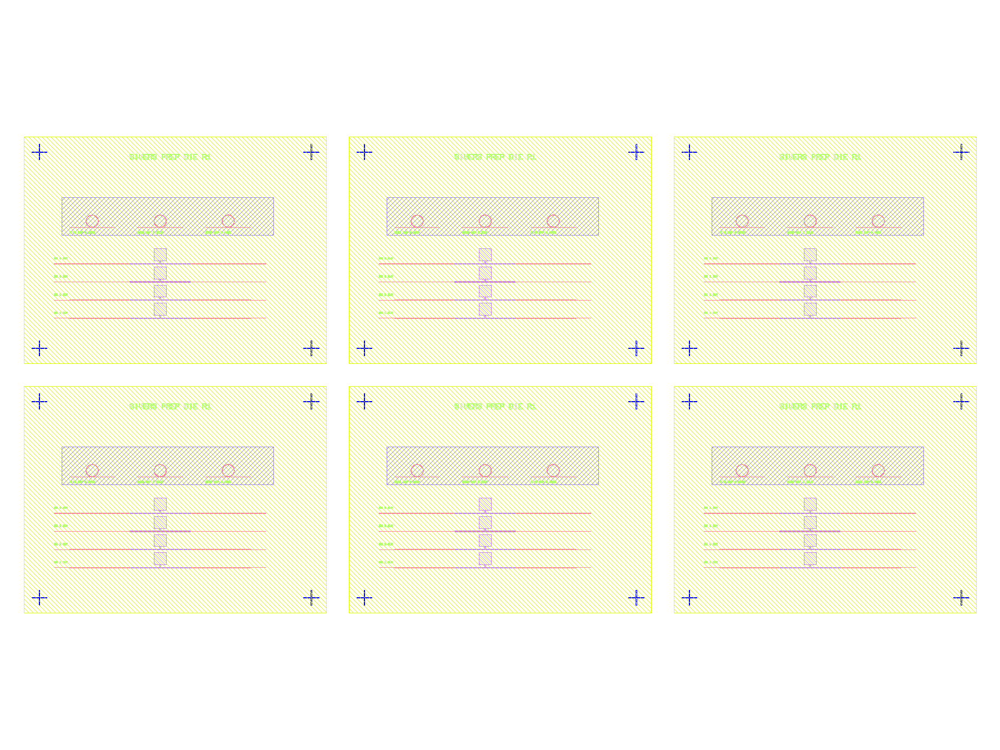
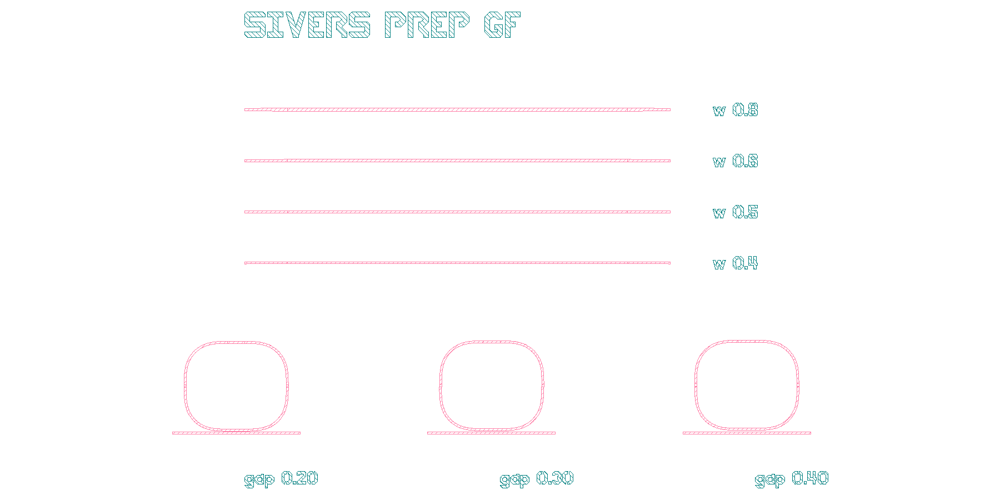
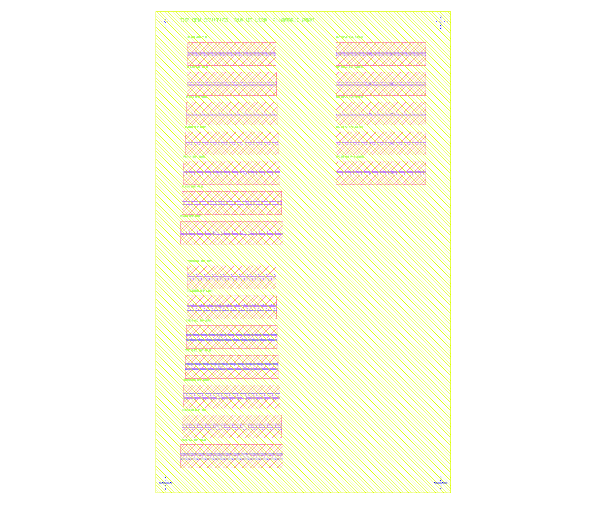
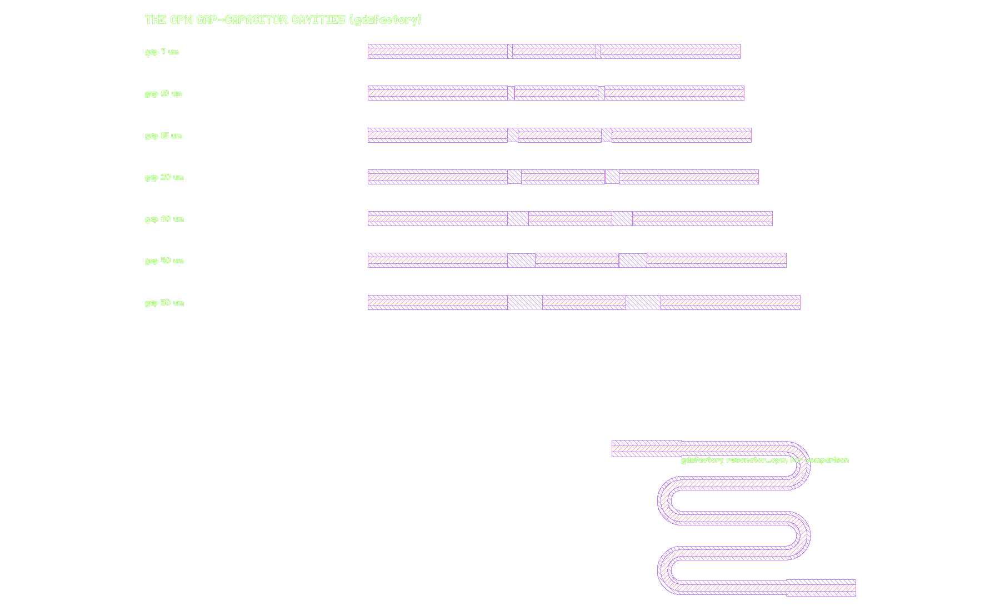

# GDS layout practice: KLayout and gdsfactory

Two scripts that build a small photonics test die, one with KLayout's Python API and one
with gdsfactory, plus a headless renderer. Written on 12 September 2026, my first time
using either tool, in the days before an introductory interview for a CAD Designer role
in a photonics fab. It is a weekend of learning, not two years of layout experience, and
it is here so I can show what I did rather than describe it.

## What is here

```
make_test_die.py        KLayout (klayout.db): polygons drawn by hand, DRC checks, GDS and OASIS out
make_ring_gf.py         gdsfactory: parametric cells from a PDK, placed and connected by port
make_thz_cpw_cavity.py  KLayout: my MSc terahertz CPW cavities as a mask layout, Boolean gap layer,
                        trench layer, DRC against a 1 um rule, GDS, OASIS and DXF out
make_thz_cpw_gf.py      gdsfactory: the same cavities from a custom CPW cross-section joined by port
render_png.py           headless GDS or OASIS to PNG using klayout.lay, no GUI needed
docs/                   klayout-and-gdsfactory-explained.md, a plain explanation of both tools
output/                 generated files (GDS, OASIS, DXF, PNG)
```

## Running it

```bash
pip install -r requirements.txt
python make_test_die.py
python make_ring_gf.py
python render_png.py output/test_die.gds output/test_die.png
python render_png.py output/ring_gf.gds output/ring_gf.png 1800 900
```

Tested with Python 3.12, klayout 0.30.12 and gdsfactory 9.50.0 on Windows 11. The KLayout
GUI (0.30.9) opens the output files directly.

## The KLayout die



A 2.0 x 1.5 mm die with six layers (waveguide ridge, metal, isolation, alignment, text,
frame). Everything is parametric: change a list at the top and the die regenerates.

- Waveguide width sweep, 1.5 to 3.0 um, each ridge with input and output tapers, a metal
  contact and a probe pad, so every device can be measured.
- Ring resonators with a coupling gap sweep of 0.20, 0.30 and 0.40 um on a 2 um bus.
- Alignment crosses in the four corners and text labels made of polygons.
- One die cell instanced in a 3 x 2 array to show hierarchy (6.30 x 3.15 mm top cell).
- Two design-rule checks on the waveguide layer: minimum width 1.0 um and minimum space
  0.15 um.
- Written out as both GDSII (28.6 kB) and OASIS (3.3 kB). OASIS is smaller because it
  stores repeated geometry and text compactly.

## The gdsfactory chip



The same idea done the way a fab with a process design kit would do it: `ring_single`,
`taper` and `straight` are parametric cells from the generic PDK, placed with `<<` and
joined with `connect()` by port name instead of by coordinate. gdsfactory 9 needs a PDK
activated before anything is built; a real fab would supply its own layer map and rules.

## My MSc terahertz cavities as a mask layout



My dissertation, "Development of Terahertz Cavities for Quantum Engineering and 6G
Communications" (University of Glasgow, 2026), simulated coplanar waveguide (CPW) cavities
in Ansys Lumerical FDTD. `make_thz_cpw_cavity.py` redraws the same geometry the way a fab
would need it, with the dissertation's own numbers: signal 10 um, slot 5 um, cavity 120 um.

- Left column: the plain gap-capacitor cavities across the 7 to 50 um coupling-gap sweep,
  then the trenched matched pair below them with the 5 um trench openings on their own
  layer. In the dissertation, widening the trenched cavity's gap from 7 to 20 um raised the
  loaded Q from 373 to 1781.
- Right column: the interdigitated capacitor (IDC) family, 2 to 10 fingers, with finger
  pitch p = 10/(2Nf - 1) um.
- The etched gap layer is not drawn. It is derived by a Boolean: the CPW window minus the
  metal. That is how a negative (etch) mask comes out of a positive drawing.
- Written out as GDSII, OASIS and DXF. DXF is what a mechanical or facilities CAD package
  would read.
- **DRC result worth knowing:** at a 1 um minimum feature rule, the IDC variants with 6, 8
  and 10 fingers (pitch 0.909, 0.667 and 0.526 um) fail on both metal and gap. Those
  variants would need e-beam lithography; the 2 and 4 finger variants could be made on a
  contact or i-line line. The simulation never had to care about that. The layout does.



`make_thz_cpw_gf.py` does the gap-capacitor sweep in gdsfactory. The CPW is a cross-section
(signal on the metal layer, two slots on the gap layer), a coupling gap is a small cell with
electrical ports, and each cavity is feed, gap, cavity, gap, feed joined by `connect()`.
gdsfactory's own `resonator_cpw` PCell, a meandered resonator of the kind used in
superconducting circuits, sits alongside for comparison.

## What I learned

- **DRC false positives.** The first width check reported 12 violations on a die that
  had none. All 12 sat at the wide end faces of the tapers. The slanted taper edge meets
  the vertical end face at 89.6 degrees, just under KLayout's default 90 degree angle
  limit, so the corner is measured as a narrow feature. Real design-rule decks set a
  lower angle limit for exactly this reason. With the limit at 80 degrees the count is 0.
  The script runs both so the difference is visible.
- **Units.** The database unit is 1 nm and every helper takes microns. Mixing the two
  is the easiest mistake to make.
- **Hierarchy.** One cell, many instances. A wafer map is an array of one die cell, not
  a copy of its polygons.
- **Layer maps belong to the process, not the script.** The tuple `(layer, datatype)`
  is only meaningful against the fab's own layer table.
- **Headless rendering.** `klayout.lay.LayoutView` renders to PNG without opening the
  GUI, which is what a CI job or a batch report would use.

## Next steps

- Turn the hand-drawn helpers into proper KLayout PCells with parameters in the GUI.
- Write the two rules as a KLayout DRC script (`.lydrc`) instead of Region calls.
- Read one real PDK layer stack end to end and rebuild the die against it.
- Reticle-level wafer map for a 100 mm wafer with edge exclusion and a flat.
